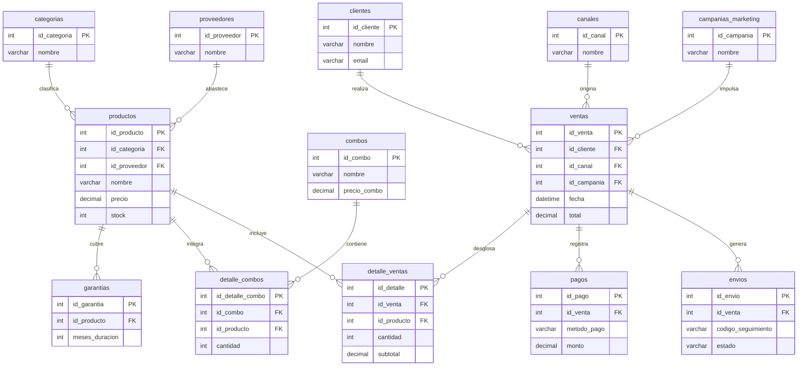

# Venta de Dispositivos Electrónicos 🛒💻

Proyecto académico de desarrollo web y base de datos para una tienda de electrónica.

## 🛠️ Tecnologías utilizadas
* **Base de Datos:** MySQL
* **Frontend:** HTML, Bootstrap 5, JavaScript
* **Backend (Próximamente):** Python (Flask)

## 📂 Estructura del Repositorio
* `índice.html`: Interfaz visual y lógica del carrito de compras.
* `Diseño de la Base de Datos...sql`: Script con la creación de tablas, relaciones y datos de prueba.

## 🗄️ Modelo Entidad-Relación (Base de Datos - 13 Tablas)

El esquema está normalizado en Tercera Forma Normal (3FN) y alojado en **TiDB Cloud (MySQL Compatible)**[cite: 2]:

